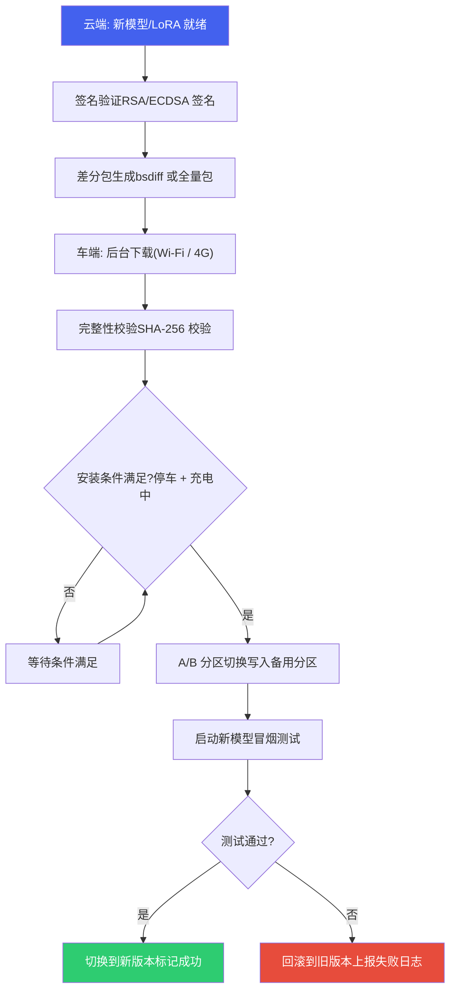

# 端侧部署与运维

*端侧模型的 OTA 更新 · 性能基准测试方法论 · 部署运维实践*

> [!TIP]
> **本篇讲什么**
>
> 端侧 AI 模型部署上线后的**运维方法论**：
>
> - OTA 模型更新：更新策略分级、安全更新流程（签名 / A-B 分区 / 回滚）
> - 性能基准测试：基准测试方法论、标准测试流程、关键性能指标
>
> 本篇是通用部署运维方法论；具体项目的部署形态（如 aadkcore 的 Service/systemd、模型配置与多 LoRA）见各项目部署文档。

## 1. OTA 模型更新

### 1.1 更新策略分级

端侧模型的 OTA 更新需要根据更新内容和风险等级选择不同策略：

| 更新类型 | 更新内容 | 包大小 | 风险等级 | 更新频率 | 回归测试 |
| :--- | :--- | :--- | :--- | :--- | :--- |
| **Prompt 热更** | System Prompt / Tool Schema 配置文件 | 数 KB | 低 | 随时 | 功能冒烟测试 |
| **LoRA 增量更新** | LoRA 适配器权重文件 | 200KB - 50MB | 低-中 | 周级 | Function Calling 准确率回归 |
| **RAG 知识更新** | 知识库向量索引 + 文档 | 10-100 MB | 低 | 按需 | 检索准确率测试 |
| **模型整体更新** | 完整模型包 / Context Binary | 2-3 GB | 高 | 月/季度级 | 全量回归测试 |
| **框架更新** | 框架库 + 插件库 | 50-100 MB | 高 | 版本发布 | 全量回归 + 兼容性测试 |

> [!NOTE]
> 表中「包大小」均为**量级示意**（用于区分更新类型的相对体量与风险），非实测值。

### 1.2 安全更新流程



> [!WARNING]
> **模型更新的安全红线**
>
> (1) **绝不在行驶中更新**：模型切换瞬间推理服务中断，必须在停车且充电状态下执行；(2) **A/B 分区保障回滚**：新模型写入备用分区，冒烟测试通过后才切换，失败自动回滚；(3) **签名校验防篡改**：防止恶意模型注入；(4) **版本兼容性**：新 LoRA 必须与当前基座模型兼容——兼容性由**模型包与配置的配对**保证，而非某个孤立的版本号字段；此外 Context Binary 还受推理工具链 / NPU 架构版本绑定（见 [LLM 推理原理与性能模型 · Genie/QAIRT 部署流程](infer-principles.html)），OTA 升级 runtime 时必须连同模型包一起重刷。

> [!NOTE]
> **原子性 / 双槽 / 回滚的落地要点（资深视角）**
>
> 上图的 A/B 切换要真正安全，需满足：
>
> - **原子切换**：模型目录的「换版」必须是原子的——用「staging 目录下载校验 → 切换 current 软链/指针」而非就地覆盖，避免某次请求读到「半旧半新」的权重（基座换了、LoRA 没换）。模型路径用目录引用时，切换指针即可让下次加载生效。
> - **双槽（dual-slot）**：A/B 两份模型包常驻 flash，`current` 指针指向其一；新包写另一槽，冒烟通过再翻指针。flash 预算紧张时也可「单槽 + 回滚包」，但要保证回滚包不被新包覆盖。
> - **回滚判据要客观**：冒烟测试不能只看「进程没崩」，要断言**实际输出**（如固定 prompt 的 Function Calling 命中、cosine 相似度阈值），否则「加载成功但输出全错」会被误判为成功。
> - **重启一致性**：翻指针后若下次启动冒烟仍失败，bootloader/看门狗应能自动回退到旧槽（标记 success 前不删旧槽）。
> - **与调度的交互**：换版/回滚瞬间在途请求会被打断，应借调度器的停止/抢占机制优雅排空，而非硬切。

## 2. 性能基准测试

### 2.1 基准测试方法论

端侧 LLM 的性能基准测试必须遵循严格的方法论，否则测试结果无法反映量产环境的真实性能：

| 测试维度 | 常见错误 | 正确做法 |
| :--- | :--- | :--- |
| **系统负载** | 单独运行 LLM（无摄像头、无渲染） | 全系统负载下测试：多路摄像头 + ISP + GPU 渲染 + LLM |
| **热状态** | 冷启动后立即测量（芯片低温） | 预热 10 分钟后测量，模拟持续使用场景 |
| **频率锁定** | 锁定 DSP 最高频率 | 使用默认 DVFS 策略，测量真实频率下的性能 |
| **输入长度** | 仅测试短 Prompt（10-20 tokens） | 测试典型场景：System Prompt 300 + User 50 + 历史对话 200 |
| **统计方法** | 报告单次或平均值 | 报告 P50/P90/P99 分位数，至少 100 次测试 |
| **内存状态** | 首次推理（KV Cache 为空） | 测试多轮对话后的推理（KV Cache 累积增长后） |

### 2.2 标准测试 Checklist

```bash
# 性能基准测试标准流程

# 1. 环境准备
echo "=== 硬件信息 ==="
cat /sys/class/thermal/thermal_zone*/temp      # 初始温度
# DSP 当前频率（节点名随 BSP/内核版本变化，下例为高通常见命名，找不到时
# 用 ls /sys/class/devfreq/ 确认实际节点，或见 hardware §7.3 的 devfreq 说明）
cat /sys/class/devfreq/soc:qcom,cdsp/cur_freq  # 示例节点名，非固定

# 2. 启动全系统负载 (模拟量产环境)
# 启动摄像头 ISP 通路
# 启动 3D 仪表盘渲染
# 启动导航地图渲染

# 3. 预热 (10 分钟稳态运行)
for i in $(seq 1 20); do
  # 发送典型推理请求
  echo "Warmup request $i"
  # curl -X POST http://localhost:8080/inference -d '...'
  sleep 30
done

# 4. 正式测试 (100 次)
echo "=== 开始正式测试 ==="
for i in $(seq 1 100); do
  START=$(date +%s%N)
  # 发送标准测试请求 (System Prompt 300tok + User 50tok)
  # 记录 TTFT, TPOT, 总生成长度, 总耗时
  END=$(date +%s%N)
  echo "Test $i: $((($END-$START)/1000000))ms"
done

# 5. 采集系统状态
cat /sys/class/thermal/thermal_zone*/temp      # 测试后温度
# 内存：QNN/HTP 的权重与 KV cache 分配在 dma-buf（system heap 经 FastRPC 映射到
# cDSP），不计入进程 VmRSS；只看 VmRSS 会低估 3 倍以上。
# 总占用 ≈ VmRSS + per-process dma-buf，且需稳态采样（KV cache 填充约 12s 后才稳定）。
PID=$(pidof <推理服务进程名>)
grep VmRSS /proc/$PID/status                   # 进程常驻集（不含 dma-buf）
dmabuf_dump $PID                               # 看 userspace_rss 列（勿用整机 dmabuf total）
# 无 dmabuf_dump 时，遍历 /proc/$PID/fdinfo 累加各 dma-buf fd 的 size
```

### 2.3 关键性能指标

| 指标 | 定义 | 目标值 | 测量方法 |
| :--- | :--- | :--- | :--- |
| **TTFT** | 从请求发送到收到第一个 token | < 800ms (P90) | 客户端记录请求发送和首 token 接收时间差 |
| **TPOT** | Decode 阶段相邻 token 间隔 | < 100ms (P90) | 流式回调中记录 token 间隔 |
| **E2E 延迟** | ASR 完成到 TTS 开始播放 | < 2s (P90) | 端到端录音分析 |
| **模型加载** | 冷启动到推理就绪 | < 5s (Context Binary) | 进程启动日志时间戳 |
| **吞吐量** | 单位时间处理的 token 总数 | > 10 tok/s | Profiling 回调统计 |
| **内存峰值** | 推理过程中**总占用**（VmRSS + per-process dma-buf）最大值 | < 4 GB（示例） | `dmabuf_dump <pid>` 看 userspace\_rss，或 VmRSS + 遍历 /proc/PID/fdinfo；**仅看 VmRSS 会低估 3 倍以上**（NPU 权重与 KV cache 在 dma-buf，不计入 VmRSS），见 §2.2 |

> [!NOTE]
> 表中「目标值」为**示例口径的设计参考目标**（用于演示「该量哪些指标、怎么量」），非某平台实测、也非保证值；请代入你自己平台与模型的实测替换（全站数据口径见 [硬件平台](hardware.html) 顶部 NOTE）。
>
> **持续算力 vs 峰值（热降频）**：端侧 SoC 在连续负载下会因热降频（thermal throttling）掉速，**冷态峰值吞吐往往显著高于热稳态**。基准必须同时报告「冷态峰值」与「预热后热稳态」两组数（§2.1 的「预热 10 分钟」正是为此），并以**热稳态作为量产口径**——只报冷态峰值会系统性高估体验与续航。TTFT / TPOT 同理要区分首请求（冷）与稳态（热）；DVFS 不锁频（§2.1）测出的才是真实持续性能。
