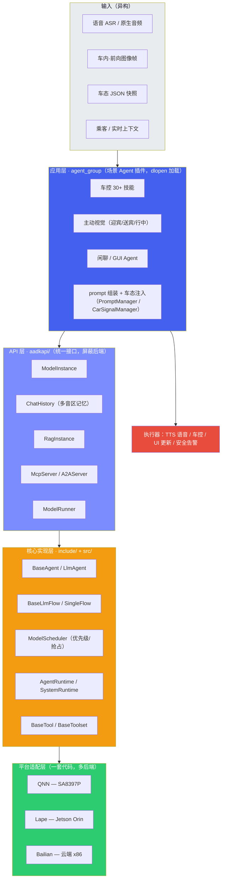

# 大模型 Agent 框架 · 项目简介

*端侧多模态大模型 Agent 框架的研发与应用 —— 摘要 · 方法总览*

> [!TIP]
> **关于本页**
>
> 这是「大模型 Agent 框架的研发与应用」项目（2024.03 – 2025.10）的简介页：**摘要 → 方法总览**。各模块的工程详解见首页该项目书架，方法总览中给出了指向各详细文档的链接。

## 1. 摘要

本项目研发了一套面向智能座舱的**端侧多模态大模型 Agent 框架**，由基础设施库 **aadkcore** 与场景插件库 **agent\_group** 组成，在车规级算力（SA8397P，Hexagon NPU 约 70 TOPS INT8）上离线运行多模态大模型，驱动车控、主动视觉等场景 Agent。**框架本身不训练、不量化模型**：端侧模型（如 Qwen3-Omni-4B INT4）取自上游已量化产物，aadkcore 本质是一个 **harness（推理后端适配 + Agent 运行时）**——向下屏蔽 QNN / Lape / Bailian 后端差异，向上把既有模型在各业务场景跑起来，工程价值在集成、适配与编排。

两个库的分工：

- **aadkcore**（`libaadkcore.so`）：统一模型接口 ModelInstance、模型调度器 ModelScheduler（四级优先级与抢占）、多音区对话管理 ChatHistory、RAG，以及 MCP / A2A 协议与 LLM Flow / Tool Use 运行时。
- **agent\_group**（`libagent_group.so`，dlopen 加载）：车控（30+ 技能）、主动视觉（迎宾/送宾/行中）、闲聊、GUI 等场景 Agent 插件。

主推 **Qwen3-Omni-4B**（INT4，原生文本/图像/音频/视频），采用 **prompt 注入式**多模态数据流，核心能力为 **Function Calling**（自然语言 → 意图解析 → Tool 调用 → 结果汇总）；设计强调端侧离线优先、安全分级（L1/L2/L3）与车态按技能裁剪。

## 2. 方法总览

本节给出框架的**整体架构**与**一条请求的处理逻辑**；各模块的实现细节不在本页展开，见对应文档（首页书架各 Part）。

**分层职责**（自上而下）：

- **输入**：语音（ASR 文本或 Qwen3-Omni 原生音频）、车内/前向图像帧、车态 JSON 快照、乘客与实时上下文——异构输入统一汇入框架。
- **应用层（agent\_group）**：车控、主动视觉、闲聊、GUI 等场景 Agent，以插件形式 dlopen 加载、按 `scenario_id` 路由；dispatcher 侧用 `PromptManager` / `CarSignalManager` 组装 prompt 并注入车态。详见 [**场景 Agent 应用**](agent-group.html)。
- **API 层（aadkapi/）**：`ModelInstance` / `ChatHistory` / `RagInstance` / `McpServer` / `A2AServer` / `ModelRunner` 等统一接口，屏蔽后端差异。详见 [**aadkcore 核心框架**](agent-core.html)。
- **核心实现层（include/ + src/）**：`BaseAgent`/`LlmAgent`、`BaseLlmFlow`/`SingleFlow`、`ModelScheduler`（优先级/抢占）、`AgentRuntime`/`SystemRuntime`、`BaseTool`/`BaseToolset`。协议与执行详见 [**协议与运行时执行**](agent-protocols.html)。
- **平台适配层**：一套代码对接 QNN（SA8397P）/ Lape（Jetson Orin）/ Bailian（云端 x86）三类后端。部署详见 [**设备部署**](deploy.html)。
- **执行器**：TTS 语音、车辆控制、UI 更新、安全告警。

**一条请求的处理链路**：

1. 上游车控服务经 Fusion/DataTransport 推来车态 JSON 快照与用户语音；场景 dispatcher 用 `PromptManager` 按场景模板组装 prompt，并把**按技能裁剪后的 `[CAR_STATE]` 文本**注入 system prompt（图像/音频走模型原生多模态输入）。
2. dispatcher 经 `ModelRunner` 把请求提交 `ModelScheduler`，按优先级/抢占调度后调用 `ModelInstance` 推理。
3. 模型输出若含 `FunctionCall`，由业务侧解析并调用对应 `BaseTool`（车控/导航等），结果汇总后生成最终回复。
4. 回复经 TTS 播报，或驱动车控/UI/告警等执行器；对话写入 `ChatHistory` 供后续轮次取用。

> 端侧模型选型与支持矩阵见 [**aadkcore 核心框架**](agent-core.html) §1.4；Function Calling 与 Tool Use 的代码现状与设计要点见 [**协议与运行时执行**](agent-protocols.html) §4；车态注入与 Prompt 模板见 [**场景 Agent 应用**](agent-group.html) §2/§7；LLM 推理优化（KV Cache/Roofline/投机采样/量化）见通识文档 [**LLM 推理原理与性能模型**](../../general/infer-principles.html)、[**端侧解码与服务化优化**](../../general/infer-serving.html)、[**端侧模型量化与压缩**](../../general/quantization.html)。
