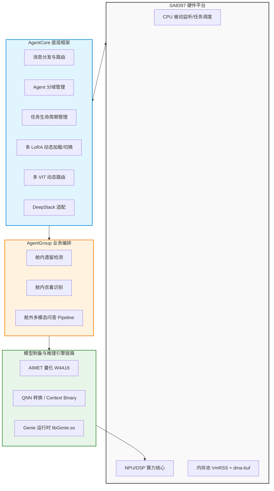
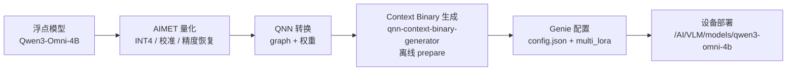
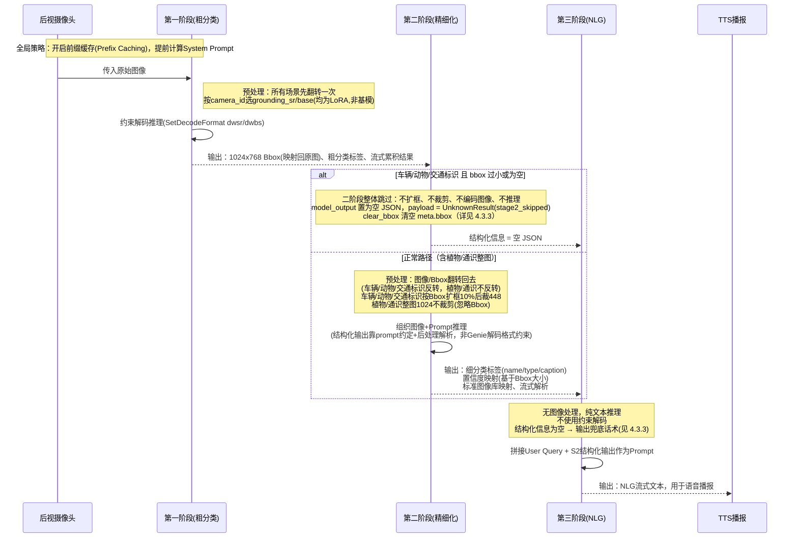

# 岚图8397量产项目SDK：核心技术架构与优化总结

*GenAI 方案 · Qwen3-Omni-4B 端侧部署 · AgentCore / AgentGroup 框架*

> [!TIP]
> **本篇讲什么**
>
> 这是岚图 8397 座舱 VLM 的 **GenAI 方案**（高通 QNN / genai 推理框架）总览，覆盖：
>
> - 系统全景与**模型制备链路**（AIMET 量化 → QNN 转换 → Context Binary 生成 → Genie 配置）
> - AgentCore 框架的**岚图分支定制点**（多 LoRA / scene / prefix 映射、多 VIT 两档路由、Genie 推理选项链与前缀缓存命中条件）
> - AgentGroup 业务编排（舱内遗留 / 衣着、舱外三阶段问答）
>
> **性能优化、车机部署与评测、关键数据核查**已归入专篇：性能 / 优化收益 / 前缀缓存 token 与预算见 [效果、性能与稳定性](effect-perf-stability.html)，部署上车见 [设备部署与上车流程](device-deployment.html)。
>
> **代码基线**：aadkcore 与 agent_group 仓库 `lantu_sdk_dev` 分支。核心文件：
>
> - AgentCore：`aadkcore/src/models/qnn/qnn_model.cpp`、`src/runtime/model_runner.cpp`
> - 模型配置：`runtime/data/config/multi_lora_runtime_config.json`（**7 条** LoRA 配置）、`config/qwen3-omni-4b_8397.json`（模型路径 + 两档 VIT）
>   - ⚠️ 同目录的 `runtime/data/config/base_model.json` 是 **Orin / Lape 形态配置**（`model_name: lape/Qwen2.5-Omni-7B`、TensorRT engine 路径），其 `enable_prefix_caching` 只被 `lape_model.cpp` 消费，**不在 8397 genai 链路上**——本篇前缀缓存开关以设备侧 Genie `config.json` 为准（见 §2.4 / §3.3）。
> - AgentGroup：`agent_group/src/{outcar_qa,incar_item_detect,dress_detect}_agent/*_dispatcher.cpp`

## 1. 背景简介与系统全景

### 1.1 项目概述

基于高通 SA8397 平台，主导 **Qwen3-Omni-4B** 多模态大模型的端侧部署与 Agent 框架研发：

- **落地业务**：舱内遗留检测、衣着识别、舱外多模态问答等核心量产业务
- **目标**：端侧大模型在智能座舱的低功耗、高实时运行

> [!NOTE]
> **锚点模型口径**：本篇的 Qwen3-Omni-4B 是**项目内部定制**的 4B 级全模态模型（**非**公开发布的 Qwen3-Omni 系列——公开版为 30B-A3B MoE）。结构按 4B 级稠密模型配置，平台与锚点定义详见 [硬件与系统底层](../../general/hardware.html) 顶部「全站数据口径与锚点模型」。

### 1.2 系统架构拓扑图

## 2. 模型制备链路（量化 → 转换 → Context Binary → Genie 配置）

端侧模型不是「训练完直接上车」。浮点大模型要经过一条**离线制备链路**，压成能在 SA8397P NPU（HTP）上低时延运行、上电即可加载的 **Context Binary**，再交给 Genie 运行时。这是端侧部署最核心、也最容易被架构总览漏掉的一环。

> [!NOTE]
> **本节口径（已核实 vs 方法级）**
>
> - **已核实**（来自 `lantu_sdk_dev` 配置与设备产物）：Context Binary `.bin` 名（`veg_448_448_8397.bin` / `veg_1024_768_8397.bin`）、模型根目录 `/AI/VLM/models/qwen3-omni-4b`、配置根目录 `/AI/vllm_sdk/models`、Genie `config.json` 字段（sampler / cl2560 / max_tokens / prefix_caching）。
> - **方法级**（高通端侧量化通用流程，项目具体参数以模型团队交付为准）：AIMET 校准集构成、量化算法选型、per-tensor / per-channel 粒度、精度恢复手段。文中已分别标注，不要把方法级描述当成项目实测结论。

### 2.1 链路总览

| 阶段 | 工具 / 产物 | 落点 |
| :--- | :--- | :--- |
| **AIMET 量化** | 量化后模型（权重 INT4，含校准与精度恢复） | 离线（模型团队） |
| **QNN 转换** | QNN graph（模型 `.so` / 中间表示） | 离线 |
| **Context Binary 生成** | `qnn-context-binary-generator` → 序列化 `.bin` | 离线 prepare，产物上车 |
| **Genie 配置** | `config.json` / `multi_lora_runtime_config.json` | `/AI/vllm_sdk/models/config` |

### 2.2 AIMET 量化

AIMET（高通开源量化工具）把浮点权重压到 **INT4**，本项目 LLM 主体走 **W4A16**（权重 INT4、激活 FP16）。量化算法（TF-Enhanced / MSE / percentile / AdaRound）、量化粒度（per-tensor / per-channel / 分组）、精度恢复（AdaRound / QAT / 混合精度）等**通用机制见 [端侧模型量化与压缩](../../general/quantization.html)**（W4A16 §3、AIMET §2、校准集 §1.4、分组打包 §3.2）。本篇只记项目强相关的取舍：

- **校准集须覆盖实际业务分布**：舱内（遗留物 / 儿童 / 衣着）+ 舱外（车辆 / 动物 / 植物 / 交通标识 / 通识）各类场景图像，且**与评测集隔离**（否则量化参数对评测分布过拟合、线上必掉点）；具体构成以模型团队交付为准。
- **VIT 同样压 INT4 是激进选择**：其激活位宽组合（weight-only W4A16 还是 W4A8）本篇未拿到模型团队明确口径；精度/时延权衡与恢复策略见 [效果·性能·稳定性篇](effect-perf-stability.html) §3.5。
- **0527 build 的量化代价**：衣着描述塌至 ~0%、植物 caption −10pp，疑与激进量化（尤其 VIT INT4）相关，是精度恢复策略需重点覆盖的对象。
- per-channel / group size 的具体取值以模型团队交付为准。
### 2.3 QNN 转换与 Context Binary 生成

QNN 转换链路（converter 消费 AIMET 已产出的量化编码 `.encodings`、**不是**在转换阶段重新量化）、Context Binary 离线 prepare 的原理（省去上电时的图编译时延、车规「上电即可用」）见 [端侧模型量化与压缩 · AIMET 与 W4A16 导出（§2.5）](../../general/quantization.html) 与 [LLM 推理原理 · Context Binary（§7.2）](../../general/infer-principles.html)。本篇只记项目产物与约束：

- **HTP backend extensions 版本约束**：`dsp_arch` 必须与 SA8397P 的 Hexagon 版本一致（本项目用 **V81** Skel，`libQnnHtpV81Skel.so`，见 [3. APK 集成](apk-integration.html) 的 `doNotStrip` 清单），否则 Context Binary 无法在设备加载。
- **产物**（已核实）：设备上的 Context Binary 包括基模、各 LoRA adapter，以及两档 VIT——`veg_448_448_8397.bin`（小档 448×448）与 `veg_1024_768_8397.bin`（大档 1024×768），统一落在 `/AI/VLM/models/qwen3-omni-4b/`（见 §2.4）。各业务实际走哪一档见 §3.2（**舱内遗留物走大档、衣着走小档**，非「舱内一律小档」）。
### 2.4 Genie 配置与模型根目录

**Genie**（GenAI Inference Extensions，`libGenie.so`）是高通端侧 LLM/VLM 对话运行时，负责加载 Context Binary + tokenizer + 配置并对外提供推理接口。**本项目推理引擎即 Genie（闭源）**。

关键配置（`config.json`，已核实）：

- sampler `greedy:true / type:basic`（greedy 单模型解码，**未启用**推测性采样）
- 上下文 `cl2560`、`max_tokens 512`
- `enable_prefix_caching=true`（前缀缓存，见 [效果·性能·稳定性篇](effect-perf-stability.html) §3.1 / §3.3）
- LoRA / scene 配置在 `multi_lora_runtime_config.json`（**7 条** LoRA 配置，映射关系见 3.1）

**两个模型根目录的关系**（已核实，全站统一口径）：

| 根目录 | 存什么 | 例子 |
| :--- | :--- | :--- |
| `/AI/VLM/models/qwen3-omni-4b` | **模型权重 / Context Binary**（`.bin`），以及 **Genie 按 `model_path` 就地解析的前缀 KV / 解码格式**（genai 包实测 `prefix/` 在 `qwen3-omni-4b/prefix`） | `base/omni3/veg_448_448_8397.bin`、各 LoRA adapter `.bin`、`prefix/<name>` |
| `/AI/vllm_sdk/models` | **SDK 直接解析的运行时配置 / 模板**（JSON） | `config/qwen3-omni-4b_8397.json`、`config/multi_lora_runtime_config.json` |

两者由配置里的 `model_path` 串联：`qwen3-omni-4b_8397.json`（在 `/AI/vllm_sdk/models/config/`）的 `model_path` 字段指向 `/AI/VLM/models/qwen3-omni-4b`，运行时据此从**权重根目录**加载 Context Binary。VIT 的 `position_ids` / `pixel_values` 等 raw 模板另落在 `/AI/VLM/models/raw_src/`。

> [!NOTE]
> **prefix / EBNF 归属：跟模型包走，不跟 SDK 配置走**
>
> 前缀 KV（`SetCommonPrefix` 按名引用）与解码格式文件是 **Genie 侧产物**，由 Genie 相对 `model_path`（即模型包 `/AI/VLM/models/qwen3-omni-4b`）解析，**不在 `/AI/vllm_sdk/models` 下**——后者只放 SDK 自己要 parse 的运行时 JSON。设备实测 genai 包的前缀在 `qwen3-omni-4b/prefix/`（与 aiservice 包把 prefix 放顶层的布局不同，见 [AIService 后端集成](aiservice-integration.html)）。也因此**换模型包版本时前缀 KV 一并换**，跨包复用旧前缀属未定义行为（具体目录层级以当期模型包为准，待随包核对）。

> [!NOTE]
> **关于旧版「方案 A/B（Genie 闭源 / GenieX 开源）」对比表**
>
> 旧版文档曾列「方案 A：Genie 闭源 / 方案 B：GenieX 开源」对比表。经核实：本项目推理引擎为高通 **Genie**（闭源，`libGenie.so`），而「GenieX 开源」**无法坐实为真实存在的高通 / 开源产品**，且该表与项目实际（走 `libGenie.so`）不符，故**删除**。若后续确有开源替代路线的评估记录，应以「方案 B 曾评估并放弃的原因」形式补回，而非与 Genie 并列对比。

## 3. AgentCore 框架：岚图分支定制点

AgentCore（aadkcore）的**通用机制**——分层架构、统一模型接口 ModelInstance、模型调度器 ModelScheduler、消息分发与路由、Agent 分域管理、对话历史 ChatHistory——属框架层通识，详见 [aadkcore 核心框架](../agent-framework/agent-core.html) 与 [场景 Agent 应用](../agent-framework/agent-group.html)。本节只记 **`lantu_sdk_dev` 分支针对岚图 8397 量产做的定制点**，不重复框架通识。

| 定制点 | 岚图分支的具体实现 | 代码落点 |
| :--- | :--- | :--- |
| **多 LoRA / scene 映射** | 7 条 LoRA 配置覆盖 4 个 scene、5 个 adapter；用 `LoRA ID`(scene) + `LoRA Name` 唯一定位并动态加载（见 3.1） | `model_runner.cpp` `getModelDetailsByScene(scene_id, lora_name)` |
| **多 VIT 两档路由** | 小档 448×448 / 大档 1024×768 两档 Context Binary，按业务设定的分辨率精确等值路由（见 3.2） | `qnn_model.cpp` `veg_model_small_` / `veg_model_large_` |
| **DeepStack 适配** | VIT 输出多路 tensor：第 0 路作主视觉 embedding，第 1..N-1 路作 DeepStack 特征一并注入 LLM，缓解深层网络遗忘图像信息（机制见 [效果·性能·稳定性篇](effect-perf-stability.html) §3.1） | `qnn_model.cpp` `buildLlmsPrompt` 里 `aios::llms::Deepstack` |
| **低功耗被动监听** | CPU 轮询改事件驱动（`poll=false`），降 SDK 进程 CPU 占用（见 [效果·性能·稳定性篇](effect-perf-stability.html) §4.2） | 配置 `poll=false` |
| **稳定性兜底** | 各业务节点异常捕获 + 空 JSON 降级，避免进程直接 Crash | 各 dispatcher |

### 3.1 多 LoRA / scene / prefix 映射关系

这是全组此前没讲清的数量关系。配置文件 `multi_lora_runtime_config.json` 的 `multi_lora.lora` 数组共 **7 条**记录，每条是一个「scene + lora_name」组合，调度层据此唯一定位一次推理该挂哪个 LoRA adapter：

| scene_id | lora_name（配置条目） | lora_path（adapter） | 对应 prefix（system_prompt KV 缓存） |
| :--- | :--- | :--- | :--- |
| 1003 | base_model | （空，走基模） | — |
| 1100 | incar_item_detect | `cnyb` | `cnyb-left`（遗留物）、`cnyb-child`（儿童 person_desc） |
| 1200 | cloth_detect | `cnyb` | `cnyb-cloth`（dress_detect） |
| 1300 | grounding_sr | `dwsr` | `dwsr`（一阶段粗分类，约束解码） |
| 1300 | grounding_base | `dwbs` | `dwbs`（无特定目标时的兜底 grounding；**仍是 dwbs adapter，非基模**，按 camera_id 选用，见 4.3 代码落点） |
| 1300 | visual_assistant | `znzs` | `znzs-car/sign/animal/plant/general`（二阶段精细化）、`znzs-nlg`（三阶段 NLG） |
| 1300 | general_base | `default_adapter` | 通识兜底（二阶段 label=通识 时挂 `znzs-general` 前缀——prefix 名与 adapter 解耦，见 4.3.2） |

**数量关系（务必分清四个层级，不要混为一谈）**：

- **4 个 scene_id**（业务域）：1003 基模 / 1100 舱内遗留 / 1200 衣着 / 1300 舱外
- **7 条配置条目**（scene + lora_name）：调度层唯一定位 adapter 的键；其中 1 条是 base_model（`lora_path` 空，走基模）
- **5 个不同的 LoRA adapter 权重**：`cnyb` / `dwsr` / `dwbs` / `znzs` / `default_adapter`——`cnyb` 被舱内遗留(1100)与衣着(1200)两个 scene **复用**，故 7 条配置只对应 5 份权重
- **11 个 prefix**（前缀缓存）：每个 system_prompt 一份 KV 缓存，与 adapter **不是一一对应**——一个 adapter（如 `znzs`）可挂多个 prefix（car/sign/animal/plant/general/nlg），故 prefix 数（11）> adapter 数（5）

> [!NOTE]
> **为什么旧版「基模 + 4 LoRA」是错的**
>
> 旧版写「基模 + 4 个 LoRA」，与配置实际的 **7 条**（5 个 adapter）不符，也与 [AIService 后端集成](aiservice-integration.html) 的「`multi_lora.lora` 数组 7 条」矛盾。本篇统一改为 **7 条 LoRA 配置 / 5 个 adapter 权重**。
>
> 另：设备 `/proc/<pid>/maps` 里可见的 **20 个 lora `.bin`** 是 adapter 在 HTP 上的实际加载产物（一个 adapter 在设备上可能对应多个 `.bin` 文件），与配置层的「5 个 adapter / 7 条」是**不同粒度的计数口径**，二者不矛盾；具体对应关系以设备产物为准。
>
> ⚠️ **观测来源标注（跨形态口径）**：这「20 个 lora `.bin`」是在 **aiservice 形态**的 `VoyahAIService` 进程 `/proc/<pid>/maps` 里观测到的（见 [AIService 后端集成 · 难点 5.2](aiservice-integration.html)）。两形态用的是**不同模型包**（版本、prefix KV、LoRA 权重 md5 均不同，见 aiservice 篇难点 5.3），故该计数**不能直接当作 genai 形态的加载产物口径**；genai 形态的 `.bin` 加载清单需对该形态进程单独核实，本篇暂沿用此观测值并标注来源。

### 3.2 多 VIT 两档路由

`qnn_model.cpp` 的 `get_vit_shape(width, height)` 按 `veg_param` 的宽高选 VIT Context Binary，**用的是精确等值匹配**（`width==1024 && height==768` / `width==448 && height==448`），不是按面积或区间归档：

- `1024×768` → 大 VIT（`veg_model_large_`，`veg_1024_768_8397.bin`）
- `448×448` → 小 VIT（`veg_model_small_`，`veg_448_448_8397.bin`）
- **非两档尺寸（fallback，注意是「两段门」，最终不是「小档出图」）**：`get_vit_shape` 两个等值条件都不命中时，`LOG_E("unsupported image size {}x{}, fallback to veg_model_small (448x448)")` 后把 **VIT 路由回退到 448 小档**并返回 `(448,448)`，预处理也按 448×448 跑——**但这不等于图像被用上**。`buildLlmsPrompt` 里真正决定「要不要把视觉 embedding 拼进 prompt」的是**另一道门**：`if ((c.resized_width==1024 && c.resized_height==768) || (c.resized_width==448 && c.resized_height==448))`，它判的是**消息里请求的原始尺寸**（`c.resized_width/height`），**不是** fallback 后的值。所以请求一个未登记尺寸（如 800×600）时：小档 VIT 仍白跑一遍，但视觉 embedding + DeepStack **不会被 Append**，只打一条 `LOG_E("image size error {} {}")`，最终退化成**纯文本推理**。排查「图像尺寸不对却仍出文本结果」时，根因往往是这道 append 门，而非 VIT 路由本身。

图像进 VIT 前先 Resize 到对应档位，减少冗余计算。两档 VIT 的 Context Binary 由 2.3 的链路离线生成。另有一处历史残留可作旁证：`preprocessImageInner` 里 `bool large_model = (resized_width > 500 || resized_height > 500)` 是**已不再使用的死变量**（无任何消费方）——说明早期确曾按面积阈值归档，现已改为纯等值匹配。

> [!NOTE]
> **各业务实际走哪一档（已对 agent_group dispatcher 核实，修正旧版「舱内 448 / 舱外 1024」的粗略说法）**
>
> 档位由 dispatcher 在 `image_info.resized_width/height` 上写死，并非「舱内一律小档、舱外一律大档」：
>
> | 业务 | dispatcher 设定的 resized 尺寸 | 实际档位 |
> | :--- | :--- | :--- |
> | 舱内**衣着**（dress_detect） | `448×448`（`kTargetW/H=448`） | 小档 |
> | 舱内**遗留物**（incar_item_detect） | `1024×768` | **大档** |
> | 舱外问答 stage1（outcar_qa） | `1024×768` | 大档 |
> | 舱外问答 stage2 | 按 `Stage2ImageMode`：`USE_FULL_1024`→`1024×768`（大档）；`USE_CROP_448`/`USE_FULL_448`→`448×448`（小档） | 视模式而定 |
>
> 即**舱内遗留物走的是大档（1024×768），不是小档**——这一点是 [效果·性能·稳定性篇](effect-perf-stability.html) §3.1 / §3.3 前缀缓存收益因场景而异的根因之一（遗留物帧的视觉 token 多，见该篇 §3.3 的预算核算 IMPORTANT）。

### 3.3 Genie 推理选项链（LoRA / 前缀 / 解码格式如何实际下发）

3.1 的「scene + lora_name 映射」与 3.2 的「VIT 档位」最终都收敛到 `qnn_model.cpp::streamGenerate` 里对 Genie `GenerateOption` 的一组 `Set*` 调用——**这才是「多 LoRA 切换 / 前缀缓存 / 约束解码」在 genai 形态的真实落点**。`lora_id` 由 `model_runner` 按 scene+name 查 `scene_named_lora_details_` 得到，是 `lora_names_`（经 `addLora` 注册的 adapter 名数组）的下标：

| Genie 选项 | 代码（`qnn_model.cpp`） | 触发条件 | 作用 |
| :--- | :--- | :--- | :--- |
| `SetLora(name)` | `prompt.Option().SetLora(lora_names_[lora_id])` | `lora_id != -1` | 选定 LoRA adapter（cnyb/dwsr/dwbs/znzs/default_adapter） |
| `SetLoraStrength(2.0)` | 硬编码 | `lora_id != -1` | LoRA 融合强度（即 Genie 的 lora_alpha），**genai 路径写死 2.0、非配置项**（配置里的 `lora_alpha` 字段不被解析器读取） |
| `SetTemperature/TopP/TopK` = `0.0/1.0/1.0` | 硬编码 | 两分支都设 | 等价 greedy，与 2.4 的 `config.json sampler greedy:true` 一致 |
| `SetCommonPrefix(prefix)` | `if(!prefix_name.empty()) SetCommonPrefix(...)` | **`lora_id != -1` 且 prefix_name 非空** | 命中前缀缓存（见 [效果·性能·稳定性篇](effect-perf-stability.html) §3.1 / §3.3） |
| `SetDecodeFormat(name)` | `if(cur_lora!="znzs" && cur_lora!="default_adapter") SetDecodeFormat(cur_lora)` | 仅 cnyb / dwsr / dwbs | 解码格式约束（见 4.3） |

> [!IMPORTANT]
> **三条容易踩的结构耦合（均已对 `qnn_model.cpp` 逐行核实）**
>
> 1. **前缀缓存与「具名 LoRA」绑定**：`SetCommonPrefix` 写在 `if (lora_id != -1)` 分支内。走基模（`lora_id == -1`，即 scene 1003 或 `__base__`/`base`/`base_model` 强制基模）时，**即使 dispatcher 传了 prefix_name 也不会下发前缀**——基模分支只设 temperature/top_p/top_k。所以「基模 + 前缀缓存」在 genai 形态**不是合法组合**。
> 2. **解码格式约束只覆盖 3 个 adapter**：`SetDecodeFormat` 对 `znzs` 与 `default_adapter` **显式跳过**（源码注释 "does not need to set"）。即舱外二阶段（visual_assistant=znzs）、三阶段 NLG（znzs）、通识兜底（general_base=default_adapter）**都不走 Genie 解码格式约束**，只有舱内 cnyb 与一阶段 grounding（dwsr/dwbs）走。这直接修正了 4.3 旧版「二阶段约束解码」的说法（见 4.3.1）。
> 3. **`SetDecodeFormat` 传的是 LoRA 名**，由 Genie 侧据此选择已注册的解码格式；**改名 / 缺对应格式会静默失效**（不报错、只是不再约束），与 [AIService 后端集成](aiservice-integration.html) 记录的 grammar 改名坑同源。genai 形态的 `multi_lora_runtime_config.json` 已**不含** `ebnf_path`/`enable_constrained_decoding` 字段（`model_runner` 里那道 `enable_constrained_decoding && ebnf_path` 门禁在本形态恒不触发），约束解码只经 `SetDecodeFormat` 这一条路。

> [!IMPORTANT]
> **前缀缓存的命中条件与逐阶段下发（genai 形态，已对代码核实）**
>
> 前缀缓存不是「开了就自动命中」，genai 形态下要**同时**满足三条：
>
> 1. **设备侧 Genie `config.json: enable_prefix_caching=true`**（总开关，见 §2.4）；
> 2. **该请求走具名 LoRA（`lora_id != -1`）**——`SetCommonPrefix` 只在具名 LoRA 分支调用；基模推理（scene 1003 / `__base__`）即使传了 prefix_name 也不下发（即上方结构耦合①）；
> 3. **dispatcher 在 `schedule_run_sync(..., prefix_name)` 末参显式传入**，且模型包内存在该 prefix 的预计算 KV（`SetCommonPrefix` 只传名字，KV 由 Genie 按名解析；缺文件 / 改名会静默不命中）。
>
> 各链路实际下发的 prefix（舱外逐 label 见 §4.3.2，舱内见 §3.1）：
>
> - 舱内遗留物 → `cnyb-left`；舱内儿童（整图 child detect）→ `cnyb-child`；舱内衣着 → `cnyb-cloth`
> - 舱外一阶段 → `dwsr`（grounding_sr）/ `dwbs`（grounding_base）
> - 舱外二阶段 → `znzs-car/animal/sign/plant/general`（按 label）
> - 舱外三阶段 NLG → `znzs-nlg`
>
> 反例（条件 3 不满足）：舱内**逐座位 person_desc 裁剪**那次 `schedule_run_sync` 未传 prefix_name，故该次推理**不命中前缀缓存**——同一 `person_desc.system_prompt` 在「整图 child detect」走 `cnyb-child`、在「逐座位 crop」不走前缀，二者不要混为一谈。

## 4. AgentGroup 业务流程

### 4.1 舱内遗留物检测（`incar_item_detect_dispatcher.cpp`）

| 阶段 | 策略 |
| :--- | :--- |
| 预处理 | 左右翻转图像（`cv::flip(full_img, flipped, 1)`，`flipCode=1` 水平翻转，解决 OMS 相机物理镜像；解码后以 BGR raw 写回 letterboxed_msg） |
| 推理 | 两次串行： ① `person_desc` 全景图识别乘员、过滤儿童 ② 遗留物 LoRA 检测 |
| 后处理 | 输出结果映射（`map_item_to_english` 物品中英映射 + `region_key_to_position` 区域→位置映射） |

**① 遗留物中英映射**（`map_item_to_english`：物品中文名**包含关键字即映射**，未命中返回空、该物品被过滤丢弃；**粗粒度归并是需求刻意设计，不要"修"**）：

| 接口英文 key | 归并的中文名（含颜色/品牌前缀也按关键字命中） |
| :--- | :--- |
| `phone` | 手机 |
| `key` | 钥匙 |
| `wallet` | 钱包 |
| `backpack` | 背包 / 书包 / 电脑包 / 挎包 / 手提包 / 帆布包 / 手提袋 / 帆布袋 |
| `laptop` | 平板 / 电脑 |
| `cup` | 水杯 / 杯子 / 马克杯 / 奶茶杯 / 咖啡杯 / 杯 / 瓶 / 壶 / 矿泉水 |

**② 遗留物区域 → 位置映射**（`region_key_to_position`：LoRA 输出 `{"left":[...],"right":[...]}` 的 region key → 接口 position）：

| LoRA region key | 接口 position |
| :--- | :--- |
| `left` | `first_row_right` |
| `middle` | `first_row_console` |
| `right` | `first_row_left` |
| `rear_left` | `second_row_right` |
| `rear_middle` | `second_row_middle` |
| `rear_right` | `second_row_left` |

> [!NOTE]
> **两处易错点**
>
> - **left↔right 是反的**：因图像已水平翻转（`cv::flip`），LoRA 输出的 `left`/`right` 与车辆实际左右互换，故 region key 与 position 的 left/right 故意对调（`left`→`first_row_right`、`right`→`first_row_left`），不是 bug。
> - **儿童检测（`person_desc`）当前走全景图、非按座位裁图**：`run_person_desc_inference` 用预处理后的整张 letterboxed 图识别所有乘员、过滤出儿童写入 `output.children`。源码里「按 `seat_pressure` 逐座位裁图 + `SEAT_REGION_MAP` 固定区域」的旧逻辑**已注释停用**（注释原文：*原有的按 seat_pressure 裁图逻辑已注释，后续算法输出解析待与算法团队核对后调整*），故座位→裁图区域映射当前不生效、不要照搬。

### 4.2 舱内衣着识别（`dress_detect_dispatcher.cpp`）

| 阶段 | 策略 |
| :--- | :--- |
| 预处理 | 左右翻转图像 + 按 `voice_zone` 裁图（`crop_by_voice_zone`，无效 zone 用全图兜底）；裁图后缩放到 448×448，走 small VIT |
| 推理 | 单次推理（衣着识别，每次都触发） |
| 后处理 | 边界值处理（避免输出为空 / "未知"）+ 置信度映射（`rand_int_in` 区间随机） |

**① voice_zone → 裁图区域映射**（`crop_by_voice_zone` 的 `kVoiceZoneMap`；`voice_zone==0` 或未知 → 返回空 Mat、用全图兜底）：

| voice_zone | 裁图区域 [x1,y1,x2,y2] | 位置 |
| :--- | :--- | :--- |
| 1 | [1286, 253, 2591, 1941] | front_left（主驾） |
| 2 | [1, 251, 1369, 1941] | front_right（副驾） |
| 4 | [1326, 8, 2032, 812] | middle_left |
| 8 | [626, 8, 1323, 812] | middle_right |
| 16 | [1326, 8, 2032, 812] | back_left |
| 32 | [626, 8, 1323, 812] | back_right |

**② 衣着属性兜底 + 置信度映射**（`fallback_arm/neck/thickness/cloth`：字段为空则从候选随机挑、置信度 0.01；neck 特殊值"未知"→"中领"、置信度 0.2~0.3；非空保持原值、置信度 `rand_int_in(80,95)` 即 0.8~0.95）：

| 属性 | 空值兜底候选（置信度 0.01） | "未知"特殊处理 | 正常置信度 |
| :--- | :--- | :--- | :--- |
| 袖子 arm | 无袖 / 短袖 / 长袖 | — | 0.8~0.95 |
| 领子 neck | 低领 / 中领 / 高领 | "未知"→"中领"，置信度 0.2~0.3 | 0.8~0.95 |
| 厚度 dressed | 厚 / 中 / 薄 | — | 0.8~0.95 |
| 衣服类型 cloth | 卫衣 / 衬衫 / T恤 | — | 0.8~0.95 |

**③ 皮肤覆盖率兜底**（`arm_occlusion` / `neck_occlusion`：字段为空时按兜底后的 cover 类型映射到随机区间，输出 `"<整数>%"` 字符串；未知类型退化为"中等覆盖"避免输出 0% 误导下游）：

| cover 类型 | 手臂皮肤覆盖 | 脖子皮肤覆盖 |
| :--- | :--- | :--- |
| 吊带 | [0, 5]% | — |
| 无袖 | [5, 10]% | — |
| 短袖 | [30, 40]% | — |
| 长袖 | [85, 90]% | — |
| 低领 | — | [1, 5]% |
| 中领 | — | [10, 20]% |
| 高领 | — | [85, 95]% |

> [!WARNING]
> **衣着置信度同样是「区间随机」的伪置信度**：与舱外 `compute_confidence_by_mapping` 一样，衣着置信度由 `rand_int_in` 在区间内随机产生（正常 0.8~0.95、neck"未知"0.2~0.3、空值兜底 0.01），**不是模型真实置信度**，同一目标多次推理会抖动，不能当精确概率用。

### 4.3 舱外问答业务 Pipeline（车辆/动物/植物/交通标识/其它）

三阶段流转（代码在 `outcar_qa_dispatcher.cpp`）：

#### 4.3.1 各阶段详细策略拆解表

| 推理阶段 | 图像与 Bbox 处理 | 推理策略与 Prompt 组织 | 输出与后处理 |
| :--- | :--- | :--- | :--- |
| **第一阶段** | ① 后视摄像头所有场景先翻转一次 ② 按 `camera_id` 选 `grounding_sr`/`grounding_base`（均为 LoRA adapter，非基模；一阶段无输入 bbox，选择依据是相机位） ③ 输出 Bbox 为 **0~1000 归一化坐标**，经 `bbox1000ToOriginal` 映射回原图像素坐标 | 约束解码（`SetDecodeFormat(dwsr/dwbs)`，见 3.3） | ① 粗分类标签 ② 流式结果累积 |
| **第二阶段** | ① 图像/Bbox 翻转回去（车辆/动物/交通标识反转，植物/通识不反转） ② **车辆/动物/交通标识**按 Bbox 扩框 10% 后裁剪到 448×448，bbox 过小/为空则跳过；**植物/通识**忽略 bbox、整图 1024×768（当前 `USE_20260423_RULE` 正式版，逐 label 见下表） ③ 类别差异化预处理 | ① 组织图像+Prompt ② **不走 Genie 解码格式约束**（znzs/default_adapter 被 `SetDecodeFormat` 显式跳过，见 3.3）；结构化输出靠 prompt 约定 + 后处理 `parseModelOutputToUnifiedByLabel` 解析 | ① 置信度映射（基于 Bbox 大小） ② 标准图像库映射 ③ 细分类标签（name/type/caption），流式解析 |
| **第三阶段** | 无图像处理 | ① 拼接用户 Query + 二阶段结构化输出作为 User Prompt ② 纯文本推理，**不使用**约束解码（znzs 同样被 `SetDecodeFormat` 跳过） | NLG 流式输出，用于 TTS 播报 |

#### 4.3.2 三阶段逐 label 决策表（`decide_stage2_by_label`，已对 `outcar_process.hpp` / `outcar_qa_dispatcher.cpp` 核实）

三阶段「用哪个 LoRA、裁不裁图、走哪档 VIT、挂哪个 prefix、置信度怎么给」全部由**一阶段 label** 决定。当前源码 `USE_20260423_RULE = true`（正式版）下的实际行为：

| 一阶段 label | 一阶段 grounding | 二阶段模型（LoRA） | 图像处理（`Stage2ImageMode`） | VIT 档 | 二阶段 prefix | bbox 门限 / 扩框 | 三阶段 NLG |
| :--- | :--- | :--- | :--- | :--- | :--- | :--- | :--- |
| 车辆 | `grounding_sr`/`base`（按 camera_id）→ dwsr/dwbs | visual_assistant（znzs） | crop 448×448（`USE_CROP_448`） | 小档 | `znzs-car` | 门限 120×120；扩框 10%；过小/空→跳过 | `znzs-nlg`，纯文本 |
| 动物 | 同上 | visual_assistant（znzs） | crop 448×448 | 小档 | `znzs-animal` | 门限 80×80；扩框 10%；过小/空→跳过 | `znzs-nlg`，纯文本 |
| 交通标识 | 同上 | visual_assistant（znzs） | crop 448×448 | 小档 | `znzs-sign` | 门限 30×30；扩框 10%；过小/空→跳过 | `znzs-nlg`，纯文本 |
| 植物 | 同上 | visual_assistant（znzs） | 整图 1024×768（`USE_FULL_1024`） | 大档 | `znzs-plant` | 忽略 bbox，不裁剪、不跳过 | `znzs-nlg`，纯文本 |
| 通识 | 同上 | **general_base（default_adapter）** | 整图 1024×768（`USE_FULL_1024`） | 大档 | `znzs-general` | 忽略 bbox，不裁剪、不跳过 | `znzs-nlg`，纯文本 |
| 其它 | 同上 | —（跳过二阶段） | `SKIP_STAGE2` | — | — | `clear_bbox`，直接走兜底回复 | 兜底文案，不进 NLG |

> [!NOTE]
> **三处易错点**
>
> - **一阶段 grounding 与 label 无关**：`grounding_sr`（camera_id 0/5，挂 dwsr adapter + `dwsr` 前缀）vs `grounding_base`（其余，挂 dwbs adapter + `dwbs` 前缀）的选择依据是**相机位**，不是 label——label 是一阶段的**产出**。一阶段本身没有输入 bbox（bbox 是它的产出）。grounding_sr/grounding_base **都是 LoRA adapter，不是基模**。
> - **通识二阶段走的是 `general_base`（default_adapter），不是 znzs**——但它的 prefix 仍叫 `znzs-general`（prefix 名与 adapter 解耦，呼应 §3.1「prefix 数 > adapter 数」）。且 default_adapter 被 `SetDecodeFormat` 跳过，故通识二阶段无解码格式约束。
> - **植物/通识在正式版下不再「bbox 为空就跳过」**：旧「临时版」逻辑（bbox 空或过小 → `SKIP_STAGE2`）已被 `USE_20260423_RULE` 分支取代为「忽略 bbox、整图 1024×768 送二阶段」。只有车辆/动物/交通标识这三个 crop 类仍保留 bbox 门限与跳过逻辑。

> [!IMPORTANT]
> **bbox 门限 / 扩框的处理时机与顺序（已对代码核实）**
>
> 一阶段模型输出的 bbox 是 **0~1000 归一化坐标**，处理链严格如下：
>
> 1. **先映射回原图**：`bbox1000ToOriginal(meta.bbox, src.cols, src.rows, 1024, 768)` 把 0~1000 坐标换算到**原图像素坐标**（`outcar_qa_dispatcher.cpp:250`）。
> 2. **再门限判定**：`decide_stage2_by_label(label, bbox)` 用**原图坐标系**下的 bbox 宽高判门限（车辆/动物 120/80、交通标识 30），过小或空则 `skip_stage2`（`:282`）。
> 3. **后扩框**：仅当不跳过、且 `image_mode == USE_CROP_448`（车辆/动物/交通标识）时，才 `expand_bbox_safe(bbox, src.cols, src.rows, 0.1)` 按 10% 扩框（`:431`），再 crop。
>
> 即：**门限和扩框都在「映射回原图」之后**（门限基于原图像素尺寸，不是 0~1000 归一值）；**顺序是先门限、后扩框**——先用原始 bbox 判是否够大，够大才扩框裁剪。植物/通识走整图、不扩框不门限。另：camera_id==5 时图像与 bbox 会先水平翻转（`cv::flip` + bbox x 坐标 `cols-x` 镜像），翻转不改变 bbox 宽高，故门限判定不受影响。

**二阶段置信度映射**（`compute_confidence_by_mapping`，`outcar_process.hpp`）：置信度**不是模型输出**，而是按 label + bbox 面积（原图像素²）映射到一个区间、再在区间内取随机值（`rand_range`，保留一位小数）。面积门限与区间：

| label | bbox 面积门限（原图像素²） | 置信度区间 |
| :--- | :--- | :--- |
| 车辆 | ≥ 40000 | 85~95% |
| 车辆 | ≥ 32400 | 75~85% |
| 车辆 | ≥ 22500 | 60~75% |
| 车辆 | < 22500 | 30~60% |
| 交通标识 / 动物 | ≥ 22500 | 80~95% |
| 交通标识 / 动物 | ≥ 10000 | 60~80% |
| 交通标识 / 动物 | < 10000 | 30~60% |
| 植物 / 通识 | 不看面积 | 65~85% |
| 其它 | — | 空（不输出 confidence） |

> [!WARNING]
> **置信度是「面积→区间→随机」的伪置信度，不是模型真实置信度**：同一目标多次推理给出的 confidence 会在区间内抖动（`rand_range` 每次随机），只能作粗粒度参考，不能当精确概率用，也不要拿它做跨帧一致性判断。

代码落点（`outcar_qa_dispatcher.cpp`）：

- 翻转：`cv::flip(src, src, 1)`（一阶段入口 + 二阶段翻回；二阶段翻回仅对车辆/动物/交通标识，且限 `camera_id==5`）
- 一阶段 grounding：`handle_view_request(msg, model_data, ...)`——按 `camera_id` 选 `grounding_sr`/`grounding_base`（见上表 NOTE）
- Bbox 映射：`bbox1000ToOriginal(meta.bbox, cols, rows, 1024, 768)`（模型输出 0~1000 → 原图坐标）
- 二阶段决策：`decide_stage2_by_label(label, bbox)`（逐 label 见上表）；二阶段走 `data_message_lora5`，模型名取 `decision.stage2_model_name`（visual_assistant / general_base），prefix 按 label 映射 `znzs-*`
- 置信度：`compute_confidence_by_mapping(label, bbox)`（按面积映射区间 + 随机取值）
- 三阶段 NLG：`schedule_run_sync(..., "visual_assistant", ..., "znzs-nlg")`，纯文本、无解码格式约束

#### 4.3.3 bbox 被门限卡住后的降级链路（车辆/动物/交通标识）

4.3.2 表中「过小/空 → 跳过」只交代了跳过二阶段，实际下游还有一整条降级链路。起点是 `decide_stage2_by_label` 给出 `skip_stage2 = true` + `clear_bbox = true`，消费点在 `outcar_qa_dispatcher.cpp:391`。

**仍会执行的操作**（按发生顺序）：

| # | 操作 | 关键取值 |
| :--- | :--- | :--- |
| 1 | 发一阶段结果帧（`stage="1"`） | `detected_item` 置空数组；`clear_bbox` 触发 `meta.bbox.clear()`；`streaming_output = "bbox: [],label: <label>"`（`:338`） |
| 2 | 发 `<STAGE_1_END>` 哨兵帧 | `stage="skipped"` |
| 3 | 发二阶段跳过帧 | `model_output = "{}"`；`payload = UnknownResult{"stage2_skipped"}` |
| 4 | 发 `<STAGE_2_END>` 哨兵帧 | 携带 `confidence`（取值见下方 WARNING） |
| 5 | **三阶段 NLG 照常推理** | user prompt = `结构化信息: {},用户指令: <query>`；`image_info` 与 `extra_images` 清空、`msg_type = TEXT`（不带图） |
| 6 | 发 `stage="3"` 流式帧 + final 帧 | `extract_nlg` 取 `nlg` 字段（`:615`）；`fill_detected_item_by_label` 对 `UnknownResult` 把各字段填空串、`position.bbox` 填空数组 |

**被跳过的操作**：二阶段的全部图像侧处理与推理——

- 不 `expand_bbox_safe` 扩框
- 不 crop 到 448×448
- 不 `fillImageInfoWithJpeg` 编码图像
- 不做二阶段推理（无 LoRA / prefix 下发）

**三阶段拿空 JSON 实际生成什么**：`outcar_qa.assistant.system_prompt`（`data/template/outcar_qa.yaml`）对空结构化信息有明文规则与示例——

> 结构化信息为空（`{}`）→ `当前暂未识别到{方位+的（有则放）}{目标主体}，请稍后再试试。`
>
> 示例：输入 `结构化信息: {},用户指令: 前边的皮卡是什么车` → 输出 `{"nlg":"当前暂未识别到前边的皮卡，请稍后再试试。"}`

方位词与目标主体由模型从**用户 query** 中抽取填入，故播报文案随 query 变化。`extract_nlg` 找第一个 `{` 解析 JSON 并取 `nlg`；**解析失败则原样返回模型输出**——三阶段无解码格式约束（见 4.3.1），格式跑偏时上屏的就是那段原始文本。

> [!WARNING]
> **被门限拒掉的目标，confidence 不是 0 而是随机 30~60%**
>
> `<STAGE_2_END>` 帧的 `confidence` 由 `compute_confidence_by_mapping(label, model_data->meta.bbox)` 计算（`outcar_process.hpp:607`），但**此时 bbox 已在上表步骤 1 被 `clear()`** → 面积恒为 0 → 落到最低档：车辆 / 动物 / 交通标识均返回 `rand_range(30, 60)`。
>
> 即「因为框太小、我们主动没去看」这件事，在协议上表现为一个 30~60% 的随机置信度，而非 0 或空。叠加 4.3.2 已说明的「面积 → 区间 → 随机」伪置信度性质，该值在此路径下不携带任何信息量。

> [!IMPORTANT]
> **空 JSON 是「二阶段没产出」的共用出口，两种语义被合并**
>
> 二阶段各 caption prompt 自身也规定了输出 `{}` 的情形——`car_caption`「完全无法判断 → 输出 `{}`」、`animal_caption` / `plant_caption`「图片中完全不存在用户所指目标 → 输出 `{}`」。因此下面两种情况：
>
> - **bbox 过小被主动跳过**（根本没有去看）
> - **看了、图里确实没有**（二阶段返回 `{}`）
>
> 都汇聚到 `结构化信息: {}`，由三阶段生成**同一句**「当前暂未识别到…，请稍后再试试。」用户与日志排查者都无法区分二者。

**这条链路上共有三种兜底话术**，来源层不同、极易混淆，排查时先分清：

| 触发条件 | 话术 | 来源 | 三阶段是否推理 |
| :--- | :--- | :--- | :--- |
| label == 其它 | 抱歉，您的问题我没听懂，请尝试询问车外实景的问题吧。 | C++ 硬编码（`:757`，`direct_return_fallback` 提前 return） | 否 |
| bbox 被门限卡 / 二阶段返回 `{}` | 当前暂未识别到…，请稍后再试试。 | 三阶段 LLM 生成 | 是 |
| 取车外图像失败 | 获取车外图像失败了，请稍后再试试 | Java 层 VRService（不进 C++） | — |

> [!NOTE]
> **证据口径**：本节链路对 `lantu_sdk_dev`（agent_group `d07d4b1`）源码与 prompt 模板逐条核实；但**尚无该路径的实测输出样本**——2026-10-24 车机 logcat 中 `暂未识别` 0 命中、`stage":"3"` 帧 0 命中。该日志里 31 条「请稍后再试试」全部是 Java 层的「获取车外图像失败了，请稍后再试试」，与本节三阶段兜底无关；两句话术高度相似，按关键字搜日志时极易误判为同一路径。三阶段实际文案以模型输出为准。
